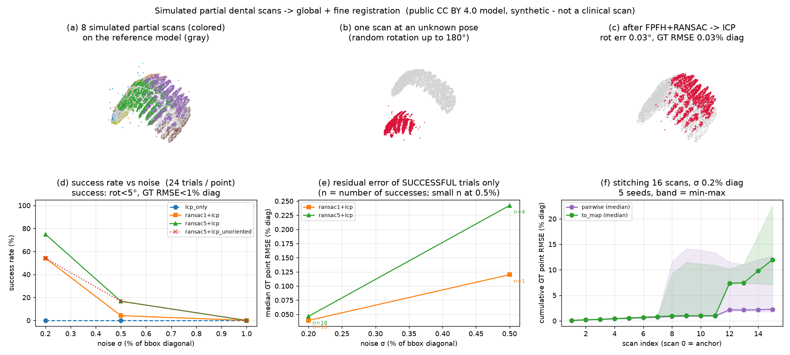

# dental-registration — 부분 치아 스캔 시뮬레이션 + 전역·정밀 정합 실험

> **Synthetic experiment on a public 3D model — not a clinical scan.**
> 실제 구강 스캐너 데이터가 아니라, 공개 3D 치열 모델(CC BY 4.0)에서 부분 스캔을 시뮬레이션해 만든 합성 실험입니다.
> 모델 좌표는 정규화된 임의 단위(bbox 대각선 3.569)라 **오차를 mm로 표기하지 않고, bbox 대각선 대비 %로** 표기합니다.



## 1. 문제

구강 스캔은 한 번에 치열 전체를 찍지 못하고, 좁은 시야로 여러 번 찍은 부분 스캔을 하나로 합칩니다.
이때 두 가지 정합 문제가 생깁니다.

- **(A) 부분 스캔 → 기준 모델 정합**: 초기 자세를 모르는 부분 스캔을 기준 3D 모델에 맞추는 문제(자세 차이가 클 수 있음).
- **(B) 부분 스캔끼리 이어붙이기(stitching)**: 연속된 스캔을 인접 스캔끼리 차례로 맞춰 합치는 문제(한 번의 오차가 뒤로 누적됨).

정답 자세를 아는 상태에서 두 문제를 재현하고, **어떤 조건에서 성공·실패하는지를 수치로** 확인하는 것이 목표입니다.

## 2. 접근

### 부분 스캔 시뮬레이션 (`simulate_scan`)
- 모델 표면에서 20만 점을 샘플링한 뒤, 스캐너 위치에서 **보이는 점만** 남김(hidden point removal).
- 스캐너 시야를 흉내 내 대상 지점 주변(bbox 대각선의 28%)만 크롭.
- **20% 점 누락 + 가우시안 노이즈(σ = 대각선의 0.2 / 0.5 / 1.0%) + 1% 이상점** 추가. 스캔 1장 평균 10,580점.
- 법선은 스캐너 시점 방향으로 정렬(스캐너는 자기 위치를 알고 있다는 가정).

### 정합 파이프라인 (Open3D 0.20)
- **전역 정합**: voxel 다운샘플(대각선의 1%) → FPFH 특징 → RANSAC(100만 회, 신뢰도 0.9999).
  가설 5개를 만들어 **ICP 적합도가 가장 높은 해**를 채택(multi-hypothesis).
- **정밀 정합**: point-to-plane ICP.
- (B)는 연속 스캔 간 움직임이 작다고 보고, coarse-to-fine ICP(대응점 거리 4 → 2 → 0.8 voxel)로 인접 스캔끼리 연결.

### 평가
- 정답 자세 대비 **회전 오차(°)**와 **점 단위 RMSE**(스캔의 모든 점을 추정 자세와 정답 자세로 각각 옮겼을 때의 거리).
- 성공 기준: 회전 오차 < 5° **그리고** 점 RMSE < 대각선의 1%.
- (A) 노이즈 3단계 × 시드 3개 × 스캔 8장 = **조건당 24회**. (B) 스캔 16장 연속, **시드 5개**.
- 파라미터 튜닝은 **보고용과 다른 시드(50, 51)**로만 수행 — 보고 수치가 튜닝에 맞춰 과대평가되지 않도록 분리.

## 3. 결과

### (A) 부분 스캔 → 기준 모델 (초기 자세: 최대 180° 회전)

| 방법 | σ 0.2% | σ 0.5% | σ 1.0% | 성공 시 중앙 회전오차 / 점 RMSE (σ 0.2%) | 평균 소요(σ 0.2%) |
|---|---|---|---|---|---|
| ICP 단독 (전역 정합 없음) | 0/24 | 0/24 | 0/24 | - | 0.04 s |
| RANSAC 1회 + ICP | 13/24 (54%) | 1/24 | 0/24 | 0.036° / 0.039% | 0.55 s |
| **RANSAC 가설 5개 + ICP** | **18/24 (75%)** | 4/24 (17%) | 0/24 | **0.039° / 0.046%** | 2.70 s |
| 위와 같되 법선 방향 미정렬 (ablation) | 13/24 (54%) | 4/24 (17%) | 0/24 | 0.054° / 0.067% | - |

- 전역 정합 없이 ICP만 쓰면 초기 자세가 크게 틀린 경우 **한 번도 수렴하지 못함** → 전역 정합이 필수.
- **가설 5개 중 선택**이 1회보다 성공률을 높임(0.2%: 13 → 18/24).
- **법선 방향 정렬**도 도움(0.2%: 13 → 18/24). 처음 설정(법선 방향 제각각·mutual filter·RANSAC 10만 회)에서는
  개발용 점검 8회 중 1회만 성공했음.
- 성공한 경우의 정밀도는 높음(중앙 회전오차 0.04°, 점 RMSE 대각선의 0.05% 미만).
- **재현 편차**: Open3D RANSAC이 멀티스레드라 실행마다 성공 횟수가 약간 달라짐. 같은 코드로 두 번 돌린 결과
  RANSAC 가설 5개 + ICP는 σ 0.2%에서 18/24 · 18/24, σ 0.5%에서 7/24 · 4/24 ([1차 결과](results/run1_summary.md), 표는 2차).

### (B) 부분 스캔 16장 연속 이어붙이기 (스텝당 움직임 ≤ 5°, ≤ 대각선의 2%)

| σ | 전략 | 최종 누적 점 RMSE: 중앙값 [최소, 최대] | 7장째 누적 RMSE (중앙값) | 결과물 vs 정답 Chamfer (중앙값) |
|---|---|---|---|---|
| 0.2% | 인접 스캔에 정합 (pairwise) | **2.249% [1.686, 12.622]** | 0.755% | 0.390% |
| 0.2% | 누적 모델 전체에 정합 (to-map) | 11.966% [7.070, 22.612] | 0.824% | 0.563% |
| 0.5% | pairwise | 10.386% [6.710, 15.008] | 1.648% | 0.881% |
| 0.5% | to-map | 7.922% [6.903, 79.296] | 7.816% | 0.994% |

- **오차는 두 방식으로 쌓임**: 겹침이 충분한 구간에서는 스텝당 중앙값 약 0.1%씩 서서히 누적되고(σ 0.2%, 1~7번째),
  **겹침이 끊기는 구간에서 한 번에 뜀** — 이 스캔 경로에서는 11→12번째 쌍이 5개 시드 모두 정합 적합도 0.0(겹치는 점 없음)이었음.
- 시드 0은 7→8번째 쌍에서도 정합이 무너져 최종 12.6%(이상치). 나머지 4개 시드는 1.69~2.34%.
- **가설과 다른 결과**: "누적 모델 전체에 맞추면 겹침 부족 구간에 강할 것"이라 보고 시험했으나, σ 0.2%에서는 오히려 악화(중앙값 2.25% → 11.97%).
  누적 모델에 이미 쌓인 오차가 다음 스캔으로 전파되고, 굵은 ICP 단계에서 비슷한 모양의 이웃 치아에 잘못 걸린 것으로 **추정**(원인 분리 실험은 하지 않음).

## 4. 한계 · 시도했지만 효과가 작았던 것

- **뒤집힌 해**: (A)의 RANSAC 가설 5개 + ICP 실패 50건 중 21건이 회전오차 150° 이상 — 좌우·상하가 비슷한 치열에서
  뒤집힌 자세로 맞춰진 경우. 5개 가설이 모두 틀리면 그중 가장 나은 것을 골라도 실패함.
- **실패는 감지 가능**: σ 0.2%에서 성공 사례의 ICP 적합도 중앙값은 0.983, 실패 사례는 0.664로 뚜렷이 갈림
  (σ 0.5%: 0.832 vs 0.545). 적합도 기준으로 실패를 걸러 재시도·재촬영을 요청할 수 있으나, 이 실험에서는 구현하지 않음.
- **노이즈 강건성**: σ 0.5% 이상에서 FPFH 특징이 급격히 무너짐. 튜닝용 시드(16회)에서 이상점 제거 + 노이즈에 맞춘 voxel 크기 +
  엄격한 가설 판별을 모두 적용해도 σ 0.5%에서 2/16 → 5/16 개선에 그쳐, 본 파이프라인에는 넣지 않음.
- **(B)의 개선 방향**: 루프 클로저·포즈 그래프 최적화(여러 스캔의 자세를 동시에 조정)가 표준 해법이지만 이 실험에서는 구현하지 않음.
- 실제 구강 스캐너의 노이즈 특성·반사·타액 등은 반영하지 않은 단순화된 시뮬레이션임.

## 5. 재현 방법

```bash
python -m venv .venv
.venv\Scripts\pip install open3d==0.20.0 trimesh numpy scipy matplotlib
set DENTITION_GLB=<Sketchfab에서 받은 permanent_dentition.glb 경로>
.venv\Scripts\python run_registration.py                 # (A)+(B)+그림, 노트북 CPU(Ryzen 7 7840HS) 기준 약 11분
.venv\Scripts\python run_registration.py --stitch-only   # (A) 결과 재사용, (B)+그림만 다시 (약 2분)
```

결과: `results/metrics.json`(모든 시행 원자료), `results/summary.md`(표), `results/figure.png`.
`dev/`는 개발 중 파라미터 점검에 쓴 스크립트 기록(현재 코드와 함수 인자가 다를 수 있음).

## 6. 출처 · 라이선스

- **3D 모델**: ["Permanent Dentition"](https://sketchfab.com/3d-models/permanent-dentition-2f69d7b59c3e4a6a8bcae041bd8e591b)
  by **DundeeDental**(University of Dundee), [CC BY 4.0](http://creativecommons.org/licenses/by/4.0/).
  **변경 사항**: 원본 메시에서 점을 샘플링하고, 가림·크롭·누락·노이즈·이상점을 더해 부분 스캔을 합성했습니다. 원본 메시 파일은 이 저장소에 포함하지 않습니다.
- **Open3D** (MIT License) — FPFH·RANSAC·ICP 구현을 라이브러리로 사용. 전역 정합 설정(voxel 기준 법선 반경 2배·특징 반경 5배,
  대응 거리 1.5 voxel, edge-length 0.9·거리 검사기)은 [Open3D Global registration 튜토리얼](https://www.open3d.org/docs/release/tutorial/pipelines/global_registration.html)의 구성을 따랐고,
  ICP는 [ICP registration 튜토리얼](https://www.open3d.org/docs/release/tutorial/pipelines/icp_registration.html)을 참고했습니다.
  부분 스캔 시뮬레이션, 다중 가설 선택, coarse-to-fine 스티칭, 평가 지표·실험 설계는 직접 작성했습니다.
- **trimesh** (MIT License) — glb 로딩.
